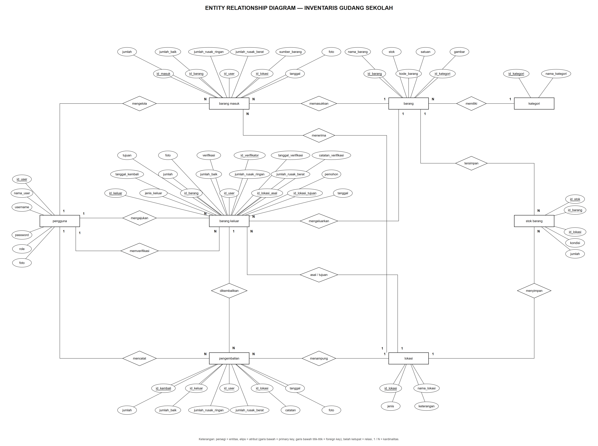
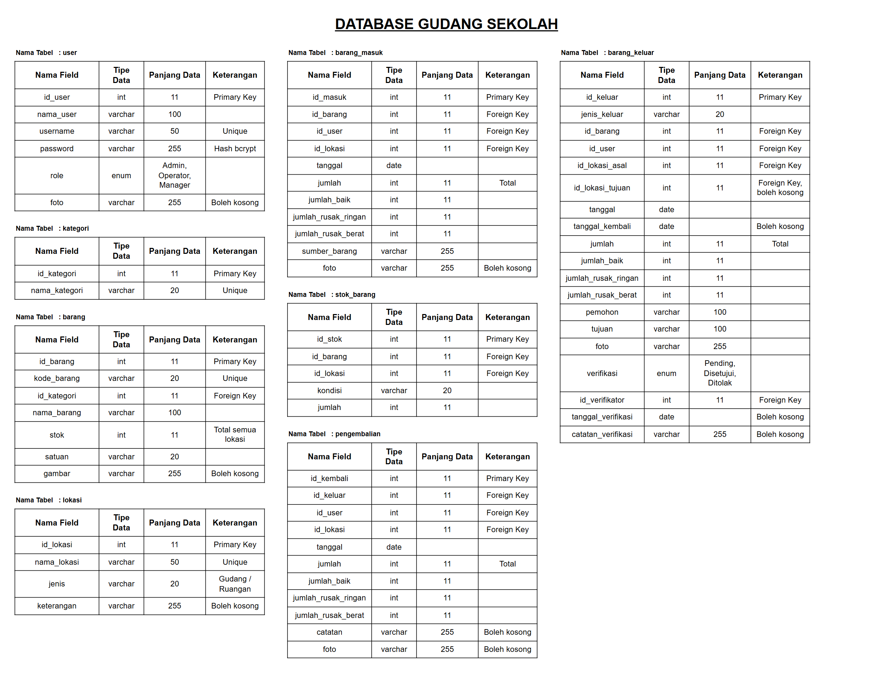
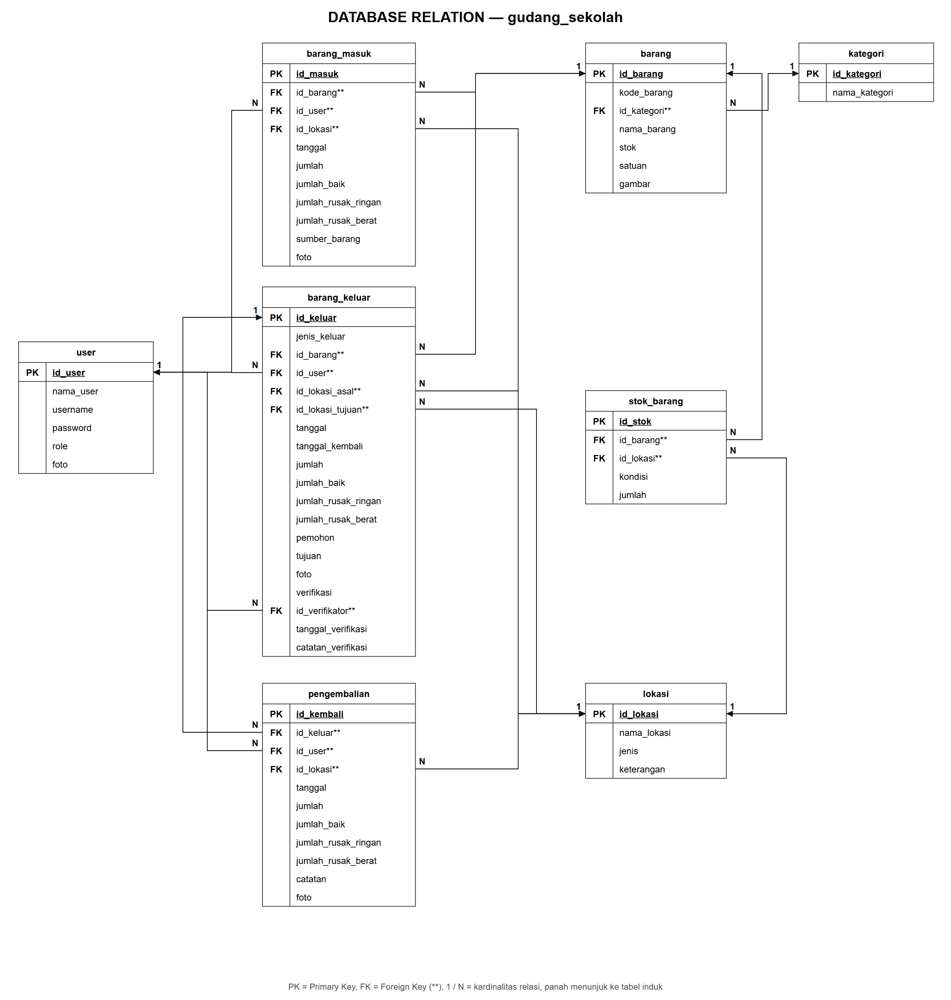
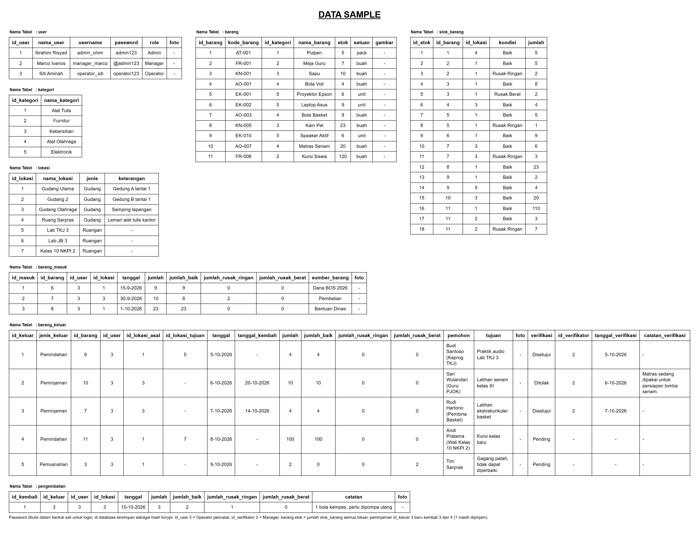

# Dokumen Rancangan Inventaris Gudang Sekolah

| No. Peserta | Nama Peserta | Aplikasi/Program | Skema |
|---|---|---|---|
| (diisi peserta) | Renaissance Ricarda Sugiarto Putra | Inventaris Gudang Sekolah | Pemrogram Junior (Junior Coder) |

Dokumen ini berisi rancangan basis data aplikasi Inventaris Gudang Sekolah: Entity Relationship Diagram, Desain Database, Database Relation, Kamus Data, dan Data Sampel. Isinya sama persis dengan struktur database pada program (folder `database/migrations`) dan data awal pada program (`database/seeders/DatabaseSeeder.php`).

<!-- daftar-isi -->

<!-- landscape -->

## 1. Entity Relationship Diagram

| No. Peserta | Nama Peserta | Aplikasi/Program | Dokumen |
|---|---|---|---|
| (diisi peserta) | Renaissance Ricarda Sugiarto Putra | Inventaris Gudang Sekolah | Entity Relationship Diagram |

Nama Database: **gudang_sekolah** · Jumlah Tabel: **8** (`user`, `kategori`, `barang`, `lokasi`, `stok_barang`, `barang_masuk`, `barang_keluar`, `pengembalian`)

<!-- portrait -->

Penjelasan relasi pada ERD:

| No | Relasi | Kardinalitas | Penjelasan |
|---|---|---|---|
| 1 | pengguna **mengelola** barang masuk | 1 : N | Satu Operator dapat mencatat banyak barang masuk (kolom `barang_masuk.id_user`). |
| 2 | pengguna **mengajukan** barang keluar | 1 : N | Satu Operator dapat mengajukan banyak barang keluar (kolom `barang_keluar.id_user`). |
| 3 | pengguna **memverifikasi** barang keluar | 1 : N | Satu Manager dapat memverifikasi banyak barang keluar (kolom `barang_keluar.id_verifikator`). |
| 4 | pengguna **mencatat** pengembalian | 1 : N | Satu Operator dapat mencatat banyak pengembalian (kolom `pengembalian.id_user`). |
| 5 | barang keluar **dikembalikan** lewat pengembalian | 1 : N | Satu peminjaman dapat dikembalikan bertahap, beberapa kali (kolom `pengembalian.id_keluar`). |
| 6 | barang masuk **memasukkan** barang | N : 1 | Banyak transaksi masuk dapat merujuk satu barang (kolom `barang_masuk.id_barang`). |
| 7 | barang keluar **mengeluarkan** barang | N : 1 | Banyak transaksi keluar dapat merujuk satu barang (kolom `barang_keluar.id_barang`). |
| 8 | barang **memiliki** kategori | N : 1 | Banyak barang berada dalam satu kategori (kolom `barang.id_kategori`). |
| 9 | barang **tersimpan** sebagai stok barang | 1 : N | Stok satu barang dipecah per lokasi dan per kondisi (kolom `stok_barang.id_barang`). |
| 10 | lokasi **menyimpan** stok barang | 1 : N | Satu lokasi menyimpan stok banyak barang (kolom `stok_barang.id_lokasi`). |
| 11 | lokasi **menerima** barang masuk | 1 : N | Barang masuk disimpan di satu lokasi (kolom `barang_masuk.id_lokasi`). |
| 12 | lokasi menjadi **asal / tujuan** barang keluar | 1 : N | Barang keluar diambil dari lokasi asal; pemindahan memiliki lokasi tujuan (kolom `id_lokasi_asal`, `id_lokasi_tujuan`). |
| 13 | lokasi **menampung** pengembalian | 1 : N | Barang yang dikembalikan disimpan ke satu lokasi (kolom `pengembalian.id_lokasi`). |

<!-- halaman-baru -->

## 2. Desain Database

| No. Peserta | Nama Peserta | Aplikasi/Program | Dokumen |
|---|---|---|---|
| (diisi peserta) | Renaissance Ricarda Sugiarto Putra | Inventaris Gudang Sekolah | Desain Database |

Nama database: **gudang_sekolah**. Foreign key memakai aturan `ON DELETE RESTRICT` (data induk tidak dapat dihapus selama masih dipakai) dan `ON UPDATE CASCADE`. Pengecualian: `stok_barang.id_barang` memakai `ON DELETE CASCADE`, karena baris stok ikut terhapus bila barangnya dihapus.

### 2.1 Tabel `user`

| Nama Field | Tipe Data | Panjang | Keterangan |
|---|---|---|---|
| id_user | int | 11 | Primary Key, auto increment |
| nama_user | varchar | 100 | Nama lengkap pengguna |
| username | varchar | 50 | Unique, dipakai untuk login |
| password | varchar | 255 | Disimpan dalam bentuk hash bcrypt |
| role | enum | 'Admin','Operator','Manager' | Hak akses pengguna |
| foto | varchar | 255 | Lokasi file foto profil, boleh kosong |

### 2.2 Tabel `kategori`

| Nama Field | Tipe Data | Panjang | Keterangan |
|---|---|---|---|
| id_kategori | int | 11 | Primary Key, auto increment |
| nama_kategori | varchar | 20 | Unique |

### 2.3 Tabel `barang`

| Nama Field | Tipe Data | Panjang | Keterangan |
|---|---|---|---|
| id_barang | int | 11 | Primary Key, auto increment |
| kode_barang | varchar | 20 | Unique, dibuat otomatis (contoh AT-001) |
| id_kategori | int | 11 | Foreign Key → kategori.id_kategori |
| nama_barang | varchar | 100 | |
| stok | int | 11 | Total stok di semua lokasi dan kondisi (jumlah dari `stok_barang`) |
| satuan | varchar | 20 | buah / unit / pack |
| gambar | varchar | 255 | Lokasi file gambar barang, boleh kosong |

### 2.4 Tabel `lokasi`

| Nama Field | Tipe Data | Panjang | Keterangan |
|---|---|---|---|
| id_lokasi | int | 11 | Primary Key, auto increment |
| nama_lokasi | varchar | 50 | Unique (contoh Gudang Utama, Gudang 2, Lab TKJ 3) |
| jenis | varchar | 20 | Gudang / Ruangan |
| keterangan | varchar | 255 | Letak lokasi, boleh kosong |

### 2.5 Tabel `stok_barang`

| Nama Field | Tipe Data | Panjang | Keterangan |
|---|---|---|---|
| id_stok | int | 11 | Primary Key, auto increment |
| id_barang | int | 11 | Foreign Key → barang.id_barang |
| id_lokasi | int | 11 | Foreign Key → lokasi.id_lokasi |
| kondisi | varchar | 20 | Baik / Rusak Ringan / Rusak Berat |
| jumlah | int | 11 | Jumlah barang dengan kondisi ini di lokasi ini |

Kombinasi `id_barang` + `id_lokasi` + `kondisi` bersifat Unique: satu barang hanya punya satu baris stok untuk setiap lokasi dan kondisi.

### 2.6 Tabel `barang_masuk`

| Nama Field | Tipe Data | Panjang | Keterangan |
|---|---|---|---|
| id_masuk | int | 11 | Primary Key, auto increment |
| id_barang | int | 11 | Foreign Key → barang.id_barang |
| id_user | int | 11 | Foreign Key → user.id_user (Operator pencatat) |
| id_lokasi | int | 11 | Foreign Key → lokasi.id_lokasi (tempat barang disimpan) |
| tanggal | date | | Tanggal barang diterima |
| jumlah | int | 11 | Total = jumlah_baik + jumlah_rusak_ringan + jumlah_rusak_berat, minimal 1 |
| jumlah_baik | int | 11 | Jumlah barang kondisi Baik |
| jumlah_rusak_ringan | int | 11 | Jumlah barang kondisi Rusak Ringan |
| jumlah_rusak_berat | int | 11 | Jumlah barang kondisi Rusak Berat |
| sumber_barang | varchar | 255 | Dana BOS / Pembelian / Bantuan Dinas |
| foto | varchar | 255 | Lokasi file foto bukti penerimaan, opsional |

### 2.7 Tabel `barang_keluar`

| Nama Field | Tipe Data | Panjang | Keterangan |
|---|---|---|---|
| id_keluar | int | 11 | Primary Key, auto increment |
| jenis_keluar | varchar | 20 | Peminjaman / Pemindahan / Pemusnahan |
| id_barang | int | 11 | Foreign Key → barang.id_barang |
| id_user | int | 11 | Foreign Key → user.id_user (Operator pengaju) |
| id_lokasi_asal | int | 11 | Foreign Key → lokasi.id_lokasi (barang diambil dari sini) |
| id_lokasi_tujuan | int | 11 | Foreign Key → lokasi.id_lokasi, hanya untuk Pemindahan |
| tanggal | date | | Tanggal pengajuan |
| tanggal_kembali | date | | Rencana tanggal kembali, hanya untuk Peminjaman |
| jumlah | int | 11 | Total = jumlah_baik + jumlah_rusak_ringan + jumlah_rusak_berat, minimal 1 |
| jumlah_baik | int | 11 | Tidak boleh melebihi stok Baik di lokasi asal |
| jumlah_rusak_ringan | int | 11 | Tidak boleh melebihi stok Rusak Ringan di lokasi asal |
| jumlah_rusak_berat | int | 11 | Tidak boleh melebihi stok Rusak Berat di lokasi asal |
| pemohon | varchar | 100 | Nama guru / staf yang meminta / meminjam barang |
| tujuan | varchar | 100 | Keperluan / alasan |
| foto | varchar | 255 | Lokasi file foto bukti permintaan (wajib di aplikasi) |
| verifikasi | enum | 'Pending','Disetujui','Ditolak' | Default Pending |
| id_verifikator | int | 11 | Foreign Key → user.id_user (Manager), boleh kosong |
| tanggal_verifikasi | date | | Boleh kosong selama Pending |
| catatan_verifikasi | varchar | 255 | Alasan / catatan, wajib bila Ditolak; berisi catatan koreksi bila Manager mengubah rincian kondisi |

### 2.8 Tabel `pengembalian`

| Nama Field | Tipe Data | Panjang | Keterangan |
|---|---|---|---|
| id_kembali | int | 11 | Primary Key, auto increment |
| id_keluar | int | 11 | Foreign Key → barang_keluar.id_keluar (peminjaman yang dikembalikan) |
| id_user | int | 11 | Foreign Key → user.id_user (Operator pencatat) |
| id_lokasi | int | 11 | Foreign Key → lokasi.id_lokasi (barang disimpan kembali ke sini) |
| tanggal | date | | Tanggal barang dikembalikan |
| jumlah | int | 11 | Total, tidak boleh melebihi sisa pinjaman |
| jumlah_baik | int | 11 | Kondisi saat kembali; bisa berbeda dari saat dipinjam |
| jumlah_rusak_ringan | int | 11 | |
| jumlah_rusak_berat | int | 11 | |
| catatan | varchar | 255 | Catatan kondisi, boleh kosong |
| foto | varchar | 255 | Foto bukti pengembalian, boleh kosong |

<!-- landscape -->

## 3. Database Relation

| No. Peserta | Nama Peserta | Aplikasi/Program | Dokumen |
|---|---|---|---|
| (diisi peserta) | Renaissance Ricarda Sugiarto Putra | Inventaris Gudang Sekolah | Database Relation |

<!-- portrait -->

## 4. Kamus Data

| No. Peserta | Nama Peserta | Aplikasi/Program | Dokumen |
|---|---|---|---|
| (diisi peserta) | Renaissance Ricarda Sugiarto Putra | Inventaris Gudang Sekolah | Kamus Data |

### 4.1 Tabel `kategori` — Field `id_kategori`

| Data | Keterangan |
|---|---|
| 1 | Alat Tulis |
| 2 | Furnitur |
| 3 | Kebersihan |
| 4 | Alat Olahraga |
| 5 | Elektronik |

### 4.2 Tabel `barang` — Field `kode_barang` (Kode Prefix)

Kode barang dibuat otomatis dengan pola **PREFIX-NOMOR** (tiga digit), nomor melanjutkan nomor terbesar pada prefix yang sama.

| Data | Keterangan |
|---|---|
| AT | Kategori Alat Tulis |
| FR | Kategori Furnitur |
| KN | Kategori Kebersihan |
| AO | Kategori Alat Olahraga |
| EK | Kategori Elektronik |

Kategori baru di luar daftar ini memakai huruf awal dua kata pertama (contoh "Alat Laboratorium" menjadi AL), atau dua huruf pertama bila hanya satu kata.

### 4.3 Tabel `user` — Field `role`

| Data | Keterangan |
|---|---|
| Admin | Pengelola sistem: mengelola pengguna, kategori, lokasi, dan data barang, serta mengoreksi data barang masuk. |
| Operator | Petugas gudang: mendaftarkan barang baru, mencatat barang masuk, mengajukan barang keluar, dan mencatat pengembalian pinjaman. |
| Manager | Pengawas: memeriksa rincian kondisi lalu menyetujui atau menolak barang keluar, serta melihat seluruh data, tanpa menambah atau mengeluarkan barang. |

### 4.4 Tabel `lokasi` — Field `jenis`

| Data | Keterangan |
|---|---|
| Gudang | Tempat menyimpan barang (Gudang Utama, Gudang 2, Gudang Olahraga, Ruang Sarpras) |
| Ruangan | Tempat barang dipakai dan tujuan pemindahan (Lab TKJ 3, Lab JB 3, kelas) |

### 4.5 Field Kondisi (`stok_barang.kondisi` dan kolom `jumlah_baik`, `jumlah_rusak_ringan`, `jumlah_rusak_berat` pada `barang_masuk`, `barang_keluar`, `pengembalian`)

| Data | Keterangan |
|---|---|
| Baik | Kondisi barang baik dan layak pakai |
| Rusak Ringan | Kondisi barang perlu diperbaiki |
| Rusak Berat | Kondisi barang tidak layak pakai, dapat dimusnahkan |

Satu transaksi dapat berisi beberapa kondisi sekaligus. Contoh: 20 barang keluar = 5 Baik, 10 Rusak Ringan, 5 Rusak Berat, sehingga `jumlah` = 20, `jumlah_baik` = 5, `jumlah_rusak_ringan` = 10, `jumlah_rusak_berat` = 5.

### 4.6 Tabel `barang_keluar` — Field `jenis_keluar`

| Data | Keterangan |
|---|---|
| Peminjaman | Barang dipinjam lalu dikembalikan. Stok berkurang selama dipinjam, data tidak dihapus; pengembalian menambah stok lagi. |
| Pemindahan | Barang dipindah ke ruangan lain (contoh Lab TKJ 3). Stok di lokasi asal berkurang dan bertambah di lokasi tujuan, sehingga total stok tetap. |
| Pemusnahan | Barang Rusak Berat dimusnahkan. Stok berkurang permanen; hanya kondisi Rusak Berat yang boleh dimusnahkan. |

### 4.7 Tabel `barang_keluar` — Field `verifikasi`

| Data | Keterangan |
|---|---|
| Pending | Permintaan masih menunggu verifikasi Manager; stok belum berubah |
| Disetujui | Disetujui Manager (rincian kondisi boleh dikoreksi lebih dulu); stok diperbarui sesuai jenis keluar |
| Ditolak | Ditolak Manager dengan alasan; stok tidak berubah |

### 4.8 Status Peminjaman (dihitung otomatis dari `barang_keluar` dan `pengembalian`, tidak disimpan sebagai kolom)

| Data | Keterangan |
|---|---|
| Dipinjam | Peminjaman disetujui dan belum ada pengembalian |
| Dikembalikan Sebagian | Sebagian barang sudah dikembalikan |
| Dikembalikan | Seluruh barang sudah dikembalikan |
| Terlambat | Lewat `tanggal_kembali` dan belum dikembalikan seluruhnya |

### 4.9 Field Gambar (`user.foto`, `barang.gambar`, `barang_masuk.foto`, `barang_keluar.foto`, `pengembalian.foto`)

| Data | Keterangan |
|---|---|
| Lokasi file, contoh `barang-keluar/Xy12Ab.jpg` | Database hanya menyimpan lokasi file, bukan isi gambar. File disimpan di folder penyimpanan (lokal) atau Supabase Storage (online). |
| Format yang diterima | JPG, JPEG, PNG, WEBP dengan ukuran maksimal 2 MB |
| Kosong (NULL) | Belum ada gambar. Foto barang keluar wajib diisi saat pengajuan baru melalui aplikasi. |

<!-- landscape -->

## 5. Data Sampel

| No. Peserta | Nama Peserta | Aplikasi/Program | Dokumen |
|---|---|---|---|
| (diisi peserta) | Renaissance Ricarda Sugiarto Putra | Inventaris Gudang Sekolah | Data Sampel |

### 5.1 Tabel `user`

| id_user | nama_user | username | password | role | foto |
|---|---|---|---|---|---|
| 1 | Ibrahim Risyad | admin_ohim | admin123 | Admin | - |
| 2 | Marco Ivanos | manager_marco | @admin123 | Manager | - |
| 3 | Siti Aminah | operator_siti | operator123 | Operator | - |

Password ditulis dalam bentuk asli agar dapat dipakai untuk login. Di dalam database, password tersimpan sebagai hash bcrypt (contoh awalan `$2y$12$...`), bukan teks asli.

### 5.2 Tabel `kategori`

| id_kategori | nama_kategori |
|---|---|
| 1 | Alat Tulis |
| 2 | Furnitur |
| 3 | Kebersihan |
| 4 | Alat Olahraga |
| 5 | Elektronik |

### 5.3 Tabel `lokasi`

| id_lokasi | nama_lokasi | jenis | keterangan |
|---|---|---|---|
| 1 | Gudang Utama | Gudang | Gedung A lantai 1 |
| 2 | Gudang 2 | Gudang | Gedung B lantai 1 |
| 3 | Gudang Olahraga | Gudang | Samping lapangan |
| 4 | Ruang Sarpras | Gudang | Lemari alat tulis kantor |
| 5 | Lab TKJ 3 | Ruangan | - |
| 6 | Lab JB 3 | Ruangan | - |
| 7 | Kelas 10 NKPI 2 | Ruangan | - |

### 5.4 Tabel `barang`

| id_barang | kode_barang | id_kategori | nama_barang | stok | satuan | gambar |
|---|---|---|---|---|---|---|
| 1 | AT-001 | 1 | Pulpen | 5 | pack | - |
| 2 | FR-001 | 2 | Meja Guru | 7 | buah | - |
| 3 | KN-001 | 3 | Sapu | 10 | buah | - |
| 4 | AO-001 | 4 | Bola Voli | 4 | buah | - |
| 5 | EK-001 | 5 | Proyektor Epson | 6 | unit | - |
| 6 | EK-002 | 5 | Laptop Asus | 9 | unit | - |
| 7 | AO-003 | 4 | Bola Basket | 9 | buah | - |
| 8 | KN-005 | 3 | Kain Pel | 23 | buah | - |
| 9 | EK-010 | 5 | Speaker Aktif | 6 | unit | - |
| 10 | AO-007 | 4 | Matras Senam | 20 | buah | - |
| 11 | FR-008 | 2 | Kursi Siswa | 120 | buah | - |

Kolom `stok` adalah total dari tabel `stok_barang` untuk barang tersebut.

### 5.5 Tabel `stok_barang`

| id_stok | id_barang | id_lokasi | kondisi | jumlah |
|---|---|---|---|---|
| 1 | 1 (AT-001) | 4 (Ruang Sarpras) | Baik | 5 |
| 2 | 2 (FR-001) | 1 (Gudang Utama) | Baik | 5 |
| 3 | 2 (FR-001) | 1 (Gudang Utama) | Rusak Ringan | 2 |
| 4 | 3 (KN-001) | 1 (Gudang Utama) | Baik | 8 |
| 5 | 3 (KN-001) | 1 (Gudang Utama) | Rusak Berat | 2 |
| 6 | 4 (AO-001) | 3 (Gudang Olahraga) | Baik | 4 |
| 7 | 5 (EK-001) | 1 (Gudang Utama) | Baik | 5 |
| 8 | 5 (EK-001) | 1 (Gudang Utama) | Rusak Ringan | 1 |
| 9 | 6 (EK-002) | 1 (Gudang Utama) | Baik | 9 |
| 10 | 7 (AO-003) | 3 (Gudang Olahraga) | Baik | 6 |
| 11 | 7 (AO-003) | 3 (Gudang Olahraga) | Rusak Ringan | 3 |
| 12 | 8 (KN-005) | 1 (Gudang Utama) | Baik | 23 |
| 13 | 9 (EK-010) | 1 (Gudang Utama) | Baik | 2 |
| 14 | 9 (EK-010) | 5 (Lab TKJ 3) | Baik | 4 |
| 15 | 10 (AO-007) | 3 (Gudang Olahraga) | Baik | 20 |
| 16 | 11 (FR-008) | 1 (Gudang Utama) | Baik | 110 |
| 17 | 11 (FR-008) | 2 (Gudang 2) | Baik | 3 |
| 18 | 11 (FR-008) | 2 (Gudang 2) | Rusak Ringan | 7 |

### 5.6 Tabel `barang_masuk`

| id_masuk | id_barang | id_user | id_lokasi | tanggal | jumlah | jumlah_baik | jumlah_rusak_ringan | jumlah_rusak_berat | sumber_barang | foto |
|---|---|---|---|---|---|---|---|---|---|---|
| 1 | 6 (EK-002) | 3 | 1 | 15-09-2026 | 9 | 9 | 0 | 0 | Dana BOS 2026 | - |
| 2 | 7 (AO-003) | 3 | 3 | 30-09-2026 | 10 | 8 | 2 | 0 | Pembelian | - |
| 3 | 8 (KN-005) | 3 | 1 | 01-10-2026 | 23 | 23 | 0 | 0 | Bantuan Dinas | - |

### 5.7 Tabel `barang_keluar`

| id_keluar | jenis_keluar | id_barang | id_lokasi_asal | id_lokasi_tujuan | tanggal | tanggal_kembali | jumlah (B/RR/RB) | pemohon | tujuan | verifikasi | id_verifikator | tanggal_verifikasi | catatan_verifikasi |
|---|---|---|---|---|---|---|---|---|---|---|---|---|---|
| 1 | Pemindahan | 9 (EK-010) | 1 | 5 | 05-10-2026 | - | 4 (4/0/0) | Budi Santoso (Kaprog TKJ) | Praktik audio Lab TKJ 3 | Disetujui | 2 | 05-10-2026 | - |
| 2 | Peminjaman | 10 (AO-007) | 3 | - | 06-10-2026 | 20-10-2026 | 10 (10/0/0) | Sari Wulandari (Guru PJOK) | Latihan senam kelas XI | Ditolak | 2 | 06-10-2026 | Matras sedang dipakai untuk persiapan lomba senam. |
| 3 | Peminjaman | 7 (AO-003) | 3 | - | 07-10-2026 | 14-10-2026 | 4 (4/0/0) | Rudi Hartono (Pembina Basket) | Latihan ekstrakurikuler basket | Disetujui | 2 | 07-10-2026 | - |
| 4 | Pemindahan | 11 (FR-008) | 1 | 7 | 08-10-2026 | - | 100 (100/0/0) | Andi Pratama (Wali Kelas 10 NKPI 2) | Kursi kelas baru | Pending | - | - | - |
| 5 | Pemusnahan | 3 (KN-001) | 1 | - | 09-10-2026 | - | 2 (0/0/2) | Tim Sarpras | Gagang patah, tidak dapat diperbaiki | Pending | - | - | - |

Semua baris memakai `id_user` = 3 (Operator) dan `foto` kosong. Kolom "jumlah (B/RR/RB)" adalah ringkasan kolom `jumlah`, `jumlah_baik`, `jumlah_rusak_ringan`, `jumlah_rusak_berat`. Data sampel barang keluar dibuat sebelum foto bukti diwajibkan; setiap pengajuan baru melalui aplikasi wajib menyertakan foto.

### 5.8 Tabel `pengembalian`

| id_kembali | id_keluar | id_user | id_lokasi | tanggal | jumlah | jumlah_baik | jumlah_rusak_ringan | jumlah_rusak_berat | catatan | foto |
|---|---|---|---|---|---|---|---|---|---|---|
| 1 | 3 | 3 | 3 | 10-10-2026 | 3 | 2 | 1 | 0 | 1 bola kempes, perlu dipompa ulang | - |

Peminjaman nomor 3 (4 bola basket) baru kembali 3, sehingga statusnya **Dikembalikan Sebagian** dan 1 bola masih dipinjam. Satu bola kembali dalam kondisi Rusak Ringan, sehingga stok Rusak Ringan bola basket di Gudang Olahraga menjadi 3.

<!-- portrait -->

## 6. Catatan Perubahan dari Rancangan Awal

| No | Rancangan Awal | Rancangan Sekarang | Alasan |
|---|---|---|---|
| 1 | Role Admin dan Manager | Admin, Operator, Manager | Pemisahan tugas: pengelola sistem, pencatat transaksi, dan pemberi persetujuan adalah orang berbeda. |
| 2 | `barang.id_barang` VARCHAR(20) berisi "AT-001" | `id_barang` INT auto increment + `kode_barang` VARCHAR(20) UNIQUE | Primary key angka lebih efisien untuk relasi; kode tetap unik dan tampil di aplikasi. |
| 3 | `password` VARCHAR(50) | VARCHAR(255), hash bcrypt | Hash bcrypt panjangnya 60 karakter; password tidak boleh disimpan sebagai teks asli. |
| 4 | `role` VARCHAR(7) | ENUM('Admin','Operator','Manager') | Nilai role terkunci sesuai kamus data. |
| 5 | Verifikasi tanpa pencatat | Tambah `id_verifikator`, `tanggal_verifikasi`, `catatan_verifikasi` | Persetujuan Manager tercatat dan dapat diaudit. |
| 6 | Tidak ada data peminta | Tambah `pemohon` | Mengetahui siapa yang meminta barang. |
| 7 | Tidak ada gambar | Tambah `user.foto`, `barang.gambar`, `barang_masuk.foto`, `barang_keluar.foto`, `pengembalian.foto` | Fitur multimedia (unggah gambar). |
| 8 | `username` tanpa batasan | UNIQUE | Username dipakai untuk login. |
| 9 | Nama database "Gudang Sekolah" | `gudang_sekolah` | Nama database sebaiknya tanpa spasi. |
| 10 | Data sampel merujuk barang yang tidak ada (EK-002, AO-003, KN-005, EK-010, AO-007, FR-008) | Keenam barang ditambahkan | Foreign key harus valid. |
| 11 | Tanggal keluar lebih awal dari tanggal masuk; jumlah keluar melebihi stok | Tanggal dan jumlah disesuaikan | Data sampel harus logis dan lolos validasi. |
| 12 | Salah ketik: "jumblah", "mengelluarkan", "id_verifikasi", "Tabel : id_kategori", "Iventaris", "Administratoer", "Keteranan", "bai" | Diperbaiki | Kerapian dokumen. |
| 13 | Barang keluar hanya satu jenis, tanpa pengembalian | Kolom `jenis_keluar` (Peminjaman / Pemindahan / Pemusnahan) dan tabel `pengembalian` | Saran pembina: barang gudang sekolah sering dipinjam; data pinjaman tidak dihapus, stok kembali saat dikembalikan. |
| 14 | `status_barang` satu nilai per transaksi | Kolom `jumlah_baik`, `jumlah_rusak_ringan`, `jumlah_rusak_berat`; kolom `status_barang` dihapus | Saran pembina: satu transaksi bisa berisi kondisi campuran (contoh 5 Baik, 10 Rusak Ringan, 5 Rusak Berat), Manager memeriksa dan dapat mengoreksi rinciannya. |
| 15 | `barang.lokasi` teks bebas, satu lokasi per barang | Tabel `lokasi` (data master) dan `stok_barang` (stok per lokasi dan kondisi) | Saran pembina: barang yang sama bisa berada di beberapa tempat (Gudang Utama, Gudang 2, ruang lab). |
